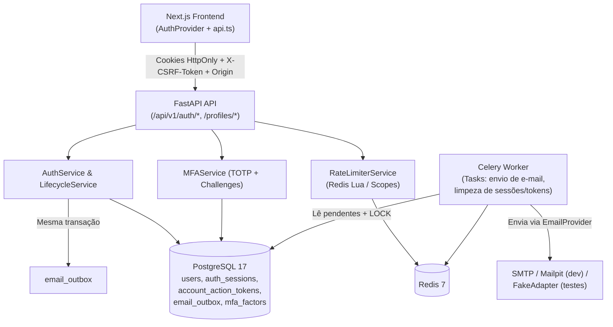
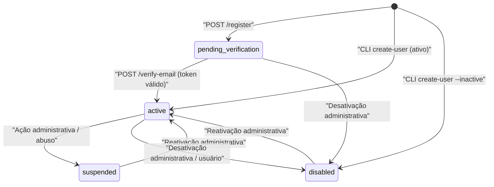

# VagaNexo AI — Arquitetura de Account Lifecycle & Security v1.0

> **Escopo:** Documento de auditoria técnica e desenho arquitetural produzido na branch `feat/account-lifecycle-security` (baseada em `main` no merge commit `0076d069e5365cb631a2e51171dfe72bb971f1c0`). Nenhuma alteração de código de produção, modelo, migração ou infraestrutura foi aplicada nesta etapa.

---

## 1. Resumo executivo

A autenticação multiusuário integrada à `main` pelo PR #4 estabelece uma base sólida: senhas com Argon2id (`argon2.PasswordHasher()`), sessões opacas persistidas apenas por hash SHA-256 (`AuthSession`), proteção CSRF por token em memória + `hmac.compare_digest()` + validação estrita de `Origin`/`Referer`, isolamento multiusuário *fail-closed* em `ProfileService`, `ResumeImportService` e `require_owned_profile`, além de rate limiting atômico em Redis.

Para evoluir do provisionamento exclusivamente administrativo (`python -m app.cli create-user`) para o ciclo completo de vida de contas (**Account Lifecycle & Security v1.0** — cadastro público, verificação de e-mail, recuperação/alteração de senha, gerenciamento de sessões, rate limiting granular, MFA TOTP e preparação para SSO OIDC), a auditoria identificou **quatro lacunas estruturais** na base atual que precisam ser endereçadas no desenho:

1. **Modelo `User` binário (`is_active` apenas):** não distingue conta pendente de verificação de e-mail, conta suspensa por segurança e conta desativada, nem registra `email_verified_at` ou `password_changed_at`.
2. **Rate limiter contabiliza sucessos:** `AuthService.authenticate()` chama `self.rate_limiter.check_login_attempt()` antes da verificação da senha, incrementando os contadores de IP e conta mesmo em logins válidos (risco de auto-bloqueio legítimo e DoS por terceiros).
3. **Ausência de infraestrutura de tokens de uso único e e-mail transacional:** não há entidade de tokens com propósito específico, fila transacional (*outbox*) ou adaptador de envio assíncrono via Celery.
4. **Ciclo de vida de sessões incompleto para autoatendimento:** `AuthSession` não armazena metadados mínimos de dispositivo/origem para exibição ao usuário, não há endpoints de listagem/revogação de outras sessões, nem mecanismo de limpeza em lotes de sessões expiradas/revogadas.

Este documento especifica a arquitetura alvo preservando integralmente as garantias já aprovadas na `main`.

---

## 2. Estado atual da autenticação

- **Branch `main`:** `0076d069e5365cb631a2e51171dfe72bb971f1c0` (CI pós-merge `46057195235`, 3/3 jobs aprovados).
- **Cadeia Alembic confirmada:** `bdd3fb3a0174` (Profile Engine) → `c8d9e0f1a2b3` (Resume Importer) → `d1e2f3a4b5c6` (`add_auth_and_profile_ownership`).
- **Modelo de identidade atual:** `User` (`users`) desacoplado de `CandidateProfile` (`candidate_profiles.user_id`, anulável para perfis legados).
- **Sessão e CSRF:** cookie `vaganexo_session` (`HttpOnly`, `SameSite=Lax`, `Path=/`, `Secure` em produção ou via `AUTH_COOKIE_SECURE`), token de sessão de 256 bits (`secrets.token_urlsafe(32)`), hash SHA-256 em `auth_sessions.token_hash` e `auth_sessions.csrf_token_hash`.
- **Provisionamento:** exclusivamente local via CLI (`create-user` e `claim-profile`).

---

## 3. Inventário dos componentes existentes

### 3.1 Backend

| Arquivo | Símbolos principais | Responsabilidade atual |
|---|---|---|
| `backend/app/models/user.py` | `User` | Conta (`id`, `email`, `password_hash`, `is_active`, timestamps); constraint `email_not_blank`; `unique=True` em `email`. |
| `backend/app/models/auth_session.py` | `AuthSession` | Sessão opaca (`user_id`, `token_hash`, `csrf_token_hash`, `created_at`, `last_seen_at`, `expires_at`, `revoked_at`). Índices em `user_id` e `expires_at`. |
| `backend/app/models/candidate_profile.py` | `CandidateProfile` | Perfil profissional com `user_id` (`FK -> users.id`, `ondelete="SET NULL"`, indexado). |
| `backend/app/auth/security.py` | `normalize_email`, `validate_password_strength`, `hash_password`, `verify_password`, `needs_rehash`, `dummy_verify_password`, `generate_session_token`, `generate_csrf_token`, `hash_token`, `verify_token_hash` | Primitivas criptográficas Argon2id (64 MiB, `time_cost=3`, `parallelism=4`), SHA-256 e `hmac.compare_digest`. |
| `backend/app/auth/service.py` | `AuthService` (`create_user`, `authenticate`, `get_active_session`, `issue_csrf_token`, `revoke_session`, `claim_profile`) | Regras de negócio de autenticação, criação/validação/revogação de sessões e reivindicação atômica de perfis. |
| `backend/app/auth/dependencies.py` | `validate_origin`, `get_current_session_and_user`, `get_current_user`, `get_current_active_user`, `require_csrf`, `require_csrf_user`, `require_owned_profile` | Dependências FastAPI para sessão, Origin/Referer, CSRF e propriedade de perfil (`404` para terceiros). |
| `backend/app/auth/rate_limit.py` | `RateLimiter`, `InMemoryRateLimiter`, `RedisLoginRateLimiter`, `_ATOMIC_INCR_EXPIRE_LUA` | Script Lua atômico (`INCR` + `EXPIRE`) com chaves `auth:rl:ip:*` e `auth:rl:acct:*`; falha fechada (`503`) em produção. |
| `backend/app/auth/exceptions.py` | `AuthError`, `InvalidCredentialsError`, `AuthenticationRequiredError`, `CSRFError`, `OriginNotAllowedError`, `RateLimitExceededError`, `RateLimiterUnavailableError`, `UserAlreadyExistsError`, `InvalidUserDataError` | Exceções de domínio mapeadas para códigos HTTP controlados. |
| `backend/app/api/routes/auth.py` | `login`, `logout`, `read_me`, `read_csrf`, `_client_ip`, `_set_session_cookie`, `_clear_session_cookie` | Rotas `/api/v1/auth/{login,logout,me,csrf}` e extração segura de IP considerando `AUTH_TRUSTED_PROXIES`. |
| `backend/app/schemas/auth.py` | `LoginRequest`, `UserPublicResponse`, `LoginResponse`, `CSRFResponse` | Contratos Pydantic herdando de `APIModel` (`extra="forbid"`). |
| `backend/app/core/config.py` | `Settings`, `get_settings` | Variáveis de ambiente (`AUTH_*`, `CORS_ORIGINS`, `REDIS_URL`, `CELERY_*`, `DATABASE_URL`). |
| `backend/app/main.py` | `create_app`, `lifespan`, exception handlers | `CORSMiddleware` explícito (sem wildcard com credenciais) e handlers de `AuthError`, `IntegrityError`, `SQLAlchemyError`. |
| `backend/app/cli.py` | `run_cli`, `_prompt_password`, `_prompt_claim_confirmation` | CLI local `create-user` (via `getpass`) e `claim-profile`. |
| `backend/app/workers/celery_app.py` | `create_celery`, `celery_app` | Instância Celery com broker/backend Redis (`task_ignore_result=True`), ainda sem tasks de e-mail ou limpeza registradas. |
| `backend/alembic/versions/d1e2f3a4b5c6_add_auth_and_profile_ownership.py` | `upgrade`, `downgrade` | Criação de `users`, `auth_sessions` e coluna `candidate_profiles.user_id`. |

### 3.2 Frontend

| Arquivo | Símbolos principais | Responsabilidade atual |
|---|---|---|
| `frontend/src/lib/api.ts` | `apiRequest`, `ensureCsrfToken`, `loginRequest`, `logoutRequest`, `fetchCurrentUser`, `fetchOwnedProfiles`, `ApiError` | `credentials: "include"`, token CSRF apenas em memória (`inMemoryCsrfToken`), deduplicação via `inFlightCsrfPromise` e retentativa única em `403` (`"CSRF validation failed"`). |
| `frontend/src/components/auth/auth-provider.tsx` | `AuthProvider`, `useAuth` | Estado global (`user`, `loading`), restauração via `/api/v1/auth/me`, redirecionamento para `/login` quando não autenticado. |
| `frontend/src/app/login/page.tsx` | `LoginPage` | Formulário de login com tratamento de `ApiError` (`401`, `403`, `429`, `503`). |
| `frontend/src/app/page.tsx` | `Home` | Listagem de perfis próprios e tratamento de `401` via `refreshSession()`. |
| `frontend/src/app/layout.tsx` | `RootLayout` | Envelopa a aplicação em `<AuthProvider>`. |

### 3.3 Infraestrutura e dependências

- **`infrastructure/compose.yaml`:** serviços `postgres` (`pgvector/pgvector:pg17`) e `redis` (`redis:7-alpine`). Não possui serviço SMTP/Mailpit nem serviço dedicado de worker Celery no Compose atual.
- **`backend/pyproject.toml`:** Python `>=3.13`, `fastapi`, `sqlalchemy`, `alembic`, `argon2-cffi`, `redis`, `celery[redis]`, `pydantic-settings`. **Não** possui ainda `pyotp`, `cryptography` (para criptografia em repouso do segredo TOTP — a confirmar na etapa de MFA) nem `authlib` (reservado para SSO futuro).
- **`.github/workflows/ci.yml`:** 3 jobs (`backend-linux` com PostgreSQL 17 + Redis 7 e teste nativo POSIX `dir_fd`, `backend-windows` e `frontend`).

---

## 4. Diagrama arquitetural



---

## 5. Modelo de ciclo de vida de contas

### 5.1 Auditoria do modelo `User` e verificação de e-mail para contas existentes

Atualmente `User` possui apenas `is_active: bool`. Adicionar `email_verified_at: datetime | None` exige decisão explícita sobre usuários já provisionados pela CLI:

| Opção | Descrição | Risco | Veredito |
|---|---|---|---|
| 1. Exigir verificação retroativa para todos | `email_verified_at = NULL` para existentes e bloqueio imediato no login. | Quebra contas legítimas criadas pela CLI em ambientes sem SMTP ativo. | **Rejeitada** |
| 2. Preservar acesso de contas existentes, exigir para novos | Novos cadastros públicos nascem com `email_verified_at = NULL`; contas criadas via CLI ou pré-existentes na migração têm tratamento explícito. | Se marcar todas como verificadas automaticamente sem critério, mascara e-mails nunca validados; se usar flag de isenção, mantém trilha clara. | **Recomendada (com distinção explícita)** |
| 3. Mecanismo explícito de migração + confirmação administrativa | Contas existentes na migração recebem `account_status = 'active'` e `email_verified_at = NULL` (ou `legacy_cli_provisioned` auditado), mantendo acesso até que alterem o e-mail ou sejam confirmadas via CLI `verify-user --email`. Novos registros públicos nascem em `pending_verification` e não recebem sessão até verificar o e-mail. | Zero quebra de compatibilidade e nenhuma falsa afirmação de que e-mails antigos foram verificados por entrega real. | **Adotada** |

> **Recomendação final:** não preencher `email_verified_at` automaticamente em contas existentes sem verificação real. Em vez disso, introduzir `status` (`pending_verification`, `active`, `suspended`, `disabled`) + `email_verified_at` (`DateTime(timezone=True) | None`). Na migração, contas existentes com `is_active = true` recebem `status = 'active'` (preservando acesso) com `email_verified_at = NULL`, enquanto novos registros via `POST /api/v1/auth/register` nascem com `status = 'pending_verification'` e `email_verified_at = NULL` (e exigem verificação antes do primeiro login). A CLI ganha `--verify-email` opcional para provisionamento administrativo.

### 5.2 Distinção conceitual obrigatória

- **Identidade autenticada:** credenciais válidas (e-mail + senha Argon2id ou OIDC verificado).
- **Conta ativa (`status == 'active'`):** conta operacional não suspensa e não desativada.
- **E-mail verificado (`email_verified_at is not None`):** comprovação de posse da caixa postal.
- **MFA habilitado (`totp_factor.enabled_at is not None`):** exige conclusão de desafio antes de emitir `AuthSession`.
- **Sessão válida (`AuthSession`):** registro não expirado, não revogado, pertencente a usuário `active`.
- **Autorização de recurso:** posse explícita (`require_owned_profile` + `user_id == current_user.id`).

### 5.3 Estados e transições



### 5.4 Matriz de acesso por estado

| Categoria de endpoint | `pending_verification` | `active` (sem MFA) | `active` (com MFA pendente) | `suspended` / `disabled` |
|---|---|---|---|---|
| `POST /register`, `/verify-email`, `/resend-verification`, `/forgot-password`, `/reset-password` | Permitido | Permitido (sem enumeração) | Permitido | Sem enumeração (não autentica) |
| `POST /login` | Bloqueado (`403` genérico ou mensagem controlada sem vazar estado em excesso) | Emite `AuthSession` | Emite `mfa_challenge` (sem `AuthSession`) | Bloqueado (`401` genérico) |
| `POST /mfa/challenge` | Negado | N/A | Emite `AuthSession` após TOTP/recovery | Negado |
| `/me`, `/csrf`, `/sessions/*`, `/change-password`, `/mfa/totp/*` | Negado (`401`) | Permitido | Negado (`401`) | Negado (`401`) |
| `/profiles/*`, `/resume-documents/*` | Negado (`401`) | Permitido (apenas recursos próprios) | Negado (`401`) | Negado (`401`) |

---

## 6. Proposta de tokens de uso único

**Decisão arquitetural:** adotar uma **entidade genérica unificada** `AccountActionToken` (`account_action_tokens`) parametrizada por `purpose` (`email_verification`, `password_reset`, `email_change`), evitando duplicação de lógica criptográfica e de consumo atômico.

### Estrutura e garantias

- **Geração:** `secrets.token_urlsafe(32)` (256 bits de entropia).
- **Persistência:** apenas `token_hash` (SHA-256 hex de 64 caracteres, índice único). Nunca armazenar o token bruto no banco ou em logs.
- **Campos:** `id` (UUID), `user_id` (`FK -> users.id`, `ON DELETE CASCADE`), `purpose` (enum/string indexada), `token_hash` (`String(64)`, único), `created_at`, `expires_at`, `consumed_at` (`nullable`), `revoked_at` (`nullable`), `requested_ip_prefix` (`String(45) | None`).
- **TTL recomendado:** 24h para `email_verification`; 30–60 min para `password_reset`.
- **Invalidação de anteriores:** ao emitir novo token para `(user_id, purpose)` (ex.: reenvio de verificação ou novo `forgot-password`), revogar tokens ativos anteriores do mesmo usuário e propósito (`UPDATE ... SET revoked_at = now() WHERE user_id = :uid AND purpose = :p AND consumed_at IS NULL AND revoked_at IS NULL`).
- **Consumo atômico (anti-TOCTOU / uso único estrito):**
  ```sql
  UPDATE account_action_tokens
  SET consumed_at = :now
  WHERE token_hash = :hash
    AND purpose = :purpose
    AND consumed_at IS NULL
    AND revoked_at IS NULL
    AND expires_at > :now
  RETURNING id, user_id;
  ```
  Se `RETURNING` retornar vazio, a operação falha fechada (`400`/`410` genérico), garantindo que duas requisições simultâneas nunca consumam o mesmo token duas vezes.
- **Limpeza:** remoção em lotes via task periódica Celery de registros com `expires_at < now() - interval '7 days'` ou `consumed_at < now() - interval '7 days'`.

---

## 7. Arquitetura de e-mail transacional

Atualmente não existe infraestrutura de e-mail no repositório.

### Desenho proposto

1. **Protocolo `EmailProvider`:** interface desacoplada com implementações:
   - `FakeEmailProvider` (testes unitários/integração, armazena mensagens em memória sem rede).
   - `SMTPEmailProvider` (SMTP padrão com TLS/STARTTLS, timeout configurável — compatível com **Mailpit** em desenvolvimento local via Compose e com qualquer relay SMTP em produção).
2. **Outbox transacional (`email_outbox`):**
   - Ao criar usuário em `/register` ou token em `/forgot-password`/`/resend-verification`, o serviço grava `AccountActionToken` e `EmailOutbox` **na mesma transação PostgreSQL**.
   - Após o `commit()`, dispara a task Celery `deliver_outbox_email.delay(outbox_id)` (se o broker falhar momentaneamente, um *sweeper* periódico reprocessa mensagens `pending` antigas).
   - **Nunca** persistir tokens brutos na `email_outbox` indefinidamente: armazenar o template + contexto mínimo ou payload criptografado/limpar o corpo após entrega (`sent_at`), e **nunca** registrar links com token ou endereços completos em logs de aplicação.
3. **Resiliência Celery:** `acks_late=True`, `max_retries=5` com *exponential backoff*, `soft_time_limit=15s`, `time_limit=30s`, e atualização de status (`pending`, `sending`, `sent`, `failed`, `attempts`, `last_error` sanitizado).
4. **URLs confiáveis:** links construídos exclusivamente a partir de `APP_PUBLIC_BASE_URL` configurada no servidor (nunca usando cabeçalho `Host` da requisição para evitar *Host Header Injection*).
5. **Token no navegador:** o link usa o fragmento (`/verify-email#token=...`), que não é enviado na requisição HTTP ao frontend nem aparece em logs de acesso do servidor. A página move o token para memória e limpa a barra de endereço; somente uma ação explícita do usuário envia o token ao endpoint POST.

---

## 8. Gerenciamento de sessões

### Auditoria da `AuthSession` atual

- Criação, expiração absoluta (`expires_at`), revogação (`revoked_at`), rotação de CSRF e `last_seen_at` já funcionam corretamente.
- **Lacunas:**
  1. Atualização de `last_seen_at` ocorre em toda requisição autenticada (`commit()` síncrono em `get_active_session`). Em alta concorrência, pode gerar contenção de linha; recomenda-se *throttling* da gravação (ex.: atualizar apenas se `now - last_seen_at > 60s`).
  2. Não há colunas para identificar contexto amigável da sessão (ex.: `user_agent_summary`, `ip_prefix` mascarado).
  3. Falta endpoint para listar sessões ativas do próprio usuário marcando `is_current` (comparando `auth_session.id == current_session.id`, **jamais** expondo `token_hash`).
  4. **Alteração/redefinição de senha:**
     - Em `reset-password` (esqueci a senha): revogar **todas** as sessões ativas do usuário (`revoked_at = now()`).
     - Em `change-password` (usuário autenticado): revogar **todas as outras** sessões (`id != current_session.id`) e rotacionar sessão/CSRF atual (ou exigir reautenticação opcional).
  5. **Índices e retenção:** manter `ix_auth_sessions_user_id`, adicionar índice composto `(user_id, revoked_at, expires_at)` para listagem rápida de sessões ativas e índice em `revoked_at` / `expires_at` para expurgo em lotes (`DELETE` em chunks de 1.000 linhas com mais de 30 dias de expiração/revogação via Celery Beat).

---

## 9. Estratégia de rate limiting

### Problema identificado na auditoria

Em `backend/app/auth/service.py` (linhas 98–101), `self.rate_limiter.check_login_attempt(...)` é executado **antes** de verificar a senha e incrementa `auth:rl:ip:*` e `auth:rl:acct:*` mesmo quando o login é bem-sucedido. Um usuário legítimo que faça 6 logins no intervalo de 5 minutos será bloqueado com `429`.

### Arquitetura proposta (multi-escopo)

Substituir o método único `check_login_attempt` por um `RateLimitService` com políticas por escopo e separação entre **verificação prévia** e **registro de falha**:

| Escopo | Chave Redis (SHA-256 truncado) | Comportamento | Limite sugerido |
|---|---|---|---|
| `login_fail_ip` | `auth:rl:login_fail:ip:<hash>` | Verifica antes; **só incrementa na falha** de credenciais; reseta/não bloqueia por sucessos. | 20 falhas / 5 min |
| `login_fail_acct` | `auth:rl:login_fail:acct:<hash>` | Verifica antes; **só incrementa na falha**; em sucesso, pode limpar contador da conta. | 5–10 falhas / 5 min |
| `register` | `auth:rl:register:ip:<hash>` | Incrementa sempre (por IP). | 5 / hora |
| `email_resend` | `auth:rl:resend:acct:<hash>` + `ip` | Incrementa sempre; protege contra spam de SMTP. | 3 / 15 min |
| `password_reset` | `auth:rl:pwreset:acct:<hash>` + `ip` | Incrementa sempre; resposta HTTP sempre `202` genérica. | 3 / 15 min |
| `mfa_challenge` | `auth:rl:mfa:chal:<id>` + `acct` | Limita tentativas de código TOTP por desafio (ex.: 5 tentativas inválidas invalidam o desafio). | 5 / desafio |
| `general_auth` | `auth:rl:gen:ip:<hash>` | Proteção ampla contra flood em `/api/v1/auth/*`. | 60 / min |

**Prevenção de DoS contra conta legítima:** `login_fail_acct` deve ter limite combinado ou janela curta com backoff, evitando que um atacante bloqueie indefinidamente uma conta apenas errando a senha de um IP externo (complementar com `login_fail_ip`). Mantém-se o comportamento *fail-closed* (`503`) em produção quando Redis estiver indisponível e a proteção de `_client_ip()` via `AUTH_TRUSTED_PROXIES`.

---

## 10. Arquitetura MFA TOTP

### Fluxo e garantias

**Regra invariante:** nenhuma `AuthSession` completa pode ser criada antes da validação do segundo fator quando MFA estiver habilitado.

1. **Entidade `UserTotpFactor` (`user_totp_factors`):**
   - `user_id` (único), `encrypted_secret` (`LargeBinary` ou `Text`), `key_version` (`SmallInteger`, permitindo rotação de chave via variável de ambiente `AUTH_MFA_ENCRYPTION_KEYS`), `enabled_at` (`nullable` — enquanto `NULL`, o fator está apenas em *enrollment* pendente), `last_used_step` (`BigInteger | None`, para prevenção estrita de *replay* no mesmo intervalo de 30s).
   - Criptografia em repouso: AEAD (`AES-256-GCM` ou `Fernet` com chave derivada por `key_version` fora do banco).
2. **Entidade `MfaRecoveryCode` (`mfa_recovery_codes`):**
   - Conjunto de 8–10 códigos de uso único (alta entropia, formato legível), persistidos apenas como hash (`SHA-256` com salt ou Argon2id), com `used_at`.
3. **Entidade `MfaChallenge` (`mfa_challenges`):**
   - Criada no `POST /login` quando `user` tem TOTP habilitado (`enabled_at IS NOT NULL`).
   - Armazena `token_hash` (cookie temporário `vaganexo_mfa_challenge`, `HttpOnly`, `SameSite=Lax`, TTL curto de 5 minutos), `user_id`, `attempts`, `expires_at`, `consumed_at`.
   - **Não é uma `AuthSession`:** `get_current_session_and_user` rejeita qualquer token que não esteja em `auth_sessions`.
4. **Provisionamento (`enroll` → `confirm`):**
   - `enroll` exige sessão ativa + CSRF + confirmação da senha atual; gera segredo de 160 bits e retorna `otpauth_uri` (QR Code renderizado no frontend, sem enviar imagem pelo servidor).
   - `confirm` valida o código TOTP (tolerância de relógio ±1 passo de 30s), grava `last_used_step`, marca `enabled_at = now()` e gera os códigos de recuperação (exibidos **uma única vez**).
5. **Desativação / regeneração:** exigem sessão ativa + CSRF + senha atual + código TOTP (ou código de recuperação).

---

## 11. Preparação para SSO (OpenID Connect)

Para evolução futura sem bloqueios estruturais:

- **Fluxo:** OIDC *Authorization Code Flow* com **PKCE** (`S256`), `state` (proteção CSRF vinculada a cookie temporário assinado/opaco) e `nonce` (anti-replay no `id_token`).
- **Validação:** verificação de assinatura via JWKS do provedor, `iss`, `aud`, `exp`, `iat` e `nonce`.
- **Modelo `ExternalIdentity` (`external_identities`):** `(provider, subject)` único vinculado a `user_id` (`FK -> users.id`).
- **Regra de segurança:** **nunca** associar automaticamente uma conta OIDC a um `User` existente apenas por coincidência de `email`. A vinculação deve exigir sessão autenticada prévia do usuário no VagaNexo + confirmação explícita (ou criação de novo `User` dedicado à identidade externa).

---

## 12. Proposta de endpoints

Todos os endpoints seguem o prefixo `/api/v1/auth`, schemas com `APIModel` (`extra="forbid"`), validação de `Origin`/`Referer` em mutações e respostas sem exposição de segredos ou enumeração de contas.

| Endpoint | Método | Auth | CSRF | Rate Limit | Payload / Resposta / Erros / Anti-enumeração |
|---|---|---|---|---|---|
| `/register` | `POST` | Pública | Origin | `register` | `{email, password}` → `202 {"detail": "..."}` (não revela se e-mail já existe em produção, ou política explícita sem vazar perfil; envia verificação ou aviso). |
| `/verify-email` | `POST` | Pública | Origin | `general_auth` | `{token}` → `200 {"detail": "email verified"}`; erros `400/410` genéricos. Consumo atômico. |
| `/resend-verification` | `POST` | Pública | Origin | `email_resend` | `{email}` → sempre `202 {"detail": "..."}` (anti-enumeração). |
| `/forgot-password` | `POST` | Pública | Origin | `password_reset` | `{email}` → sempre `202 {"detail": "..."}` (anti-enumeração; `dummy_verify`/tempo constante se necessário). |
| `/reset-password` | `POST` | Pública | Origin | `password_reset` | `{token, new_password}` → `200`; consome token atomicamente, atualiza hash Argon2id, revoga **todas** as sessões em transação única. |
| `/change-password` | `POST` | Sessão | Sim | `general_auth` | `{current_password, new_password}` → `200`; valida senha atual, atualiza hash, revoga outras sessões. |
| `/sessions` | `GET` | Sessão | Não | `general_auth` | Lista sessões ativas do `current_user` (`id`, `created_at`, `last_seen_at`, `expires_at`, `is_current`, `ip_prefix`, `user_agent_summary`). |
| `/sessions/{session_id}` | `DELETE` | Sessão | Sim | `general_auth` | Revoga sessão específica do `current_user`; retorna `404` se pertencer a outro usuário. |
| `/sessions/revoke-others` | `POST` | Sessão | Sim | `general_auth` | Revoga todas as sessões do `current_user` exceto a atual; `200 {"revoked_count": N}`. |
| `/mfa/totp/enroll` | `POST` | Sessão | Sim | `general_auth` | `{current_password}` → `200 {secret, otpauth_uri}`. |
| `/mfa/totp/confirm` | `POST` | Sessão | Sim | `mfa_challenge` | `{code}` → `200 {recovery_codes: [...]}` (exibidos uma única vez). |
| `/mfa/totp/disable` | `POST` | Sessão | Sim | `mfa_challenge` | `{current_password, code}` → `204`. |
| `/mfa/challenge` | `POST` | Cookie `mfa_challenge` | Origin | `mfa_challenge` | `{code}` (TOTP ou recovery) → `200 LoginResponse` + seta cookie `vaganexo_session` e limpa cookie de desafio. |
| `/mfa/recovery-codes/regenerate` | `POST` | Sessão | Sim | `mfa_challenge` | `{current_password, code}` → `200 {recovery_codes: [...]}` (invalida códigos anteriores na mesma transação). |

---

## 13. Proposta de modelos de dados

```mermaid
erDiagram
    users ||--o{ auth_sessions : "has"
    users ||--o{ candidate_profiles : "owns"
    users ||--o{ account_action_tokens : "has"
    users ||--o{ email_outbox : "receives"
    users ||--o| user_totp_factors : "has"
    users ||--o{ mfa_recovery_codes : "has"
    users ||--o{ mfa_challenges : "has"
    users ||--o{ external_identities : "future SSO"

    users {
        uuid id PK
        string email UK
        string password_hash
        boolean is_active
        string status
        timestamptz email_verified_at
        timestamptz password_changed_at
    }
    auth_sessions {
        uuid id PK
        uuid user_id FK
        string token_hash UK
        string csrf_token_hash
        string ip_prefix
        string user_agent_summary
        timestamptz expires_at
        timestamptz revoked_at
    }
    account_action_tokens {
        uuid id PK
        uuid user_id FK
        string purpose
        string token_hash UK
        timestamptz expires_at
        timestamptz consumed_at
        timestamptz revoked_at
    }
    email_outbox {
        uuid id PK
        uuid user_id FK
        string recipient_email
        string template_name
        string status
        int attempts
        timestamptz sent_at
    }
    user_totp_factors {
        uuid id PK
        uuid user_id FK_UK
        bytes encrypted_secret
        smallint key_version
        timestamptz enabled_at
        bigint last_used_step
    }
    mfa_recovery_codes {
        uuid id PK
        uuid user_id FK
        string code_hash
        timestamptz used_at
    }
    mfa_challenges {
        uuid id PK
        uuid user_id FK
        string token_hash UK
        int attempts
        timestamptz expires_at
        timestamptz consumed_at
    }
```

---

## 14. Estratégia de migrações

Partindo da revisão atual `d1e2f3a4b5c6`, recomenda-se dividir em revisões incrementais alinhadas às fases de entrega (sempre validadas em `vaganexo_migration_test` com teste de `upgrade` e `downgrade`):

1. **Revisão A (Cadastro, Verificação, Tokens e Outbox):**
   - `ALTER TABLE users`: adicionar `status` (`VARCHAR(32)`, `NOT NULL`, `server_default='active'` para preservar existentes, atualizado para `'disabled'` onde `is_active = false`), `email_verified_at` (`TIMESTAMPTZ`, `NULL`), `password_changed_at` (`TIMESTAMPTZ`, `NULL`).
   - `CREATE TABLE account_action_tokens`: índices em `(token_hash)` (único), `(user_id, purpose)` e `(expires_at)`.
   - `CREATE TABLE email_outbox`: índices em `(status, created_at)` e `(user_id)`.
   - **Downgrade:** `DROP TABLE email_outbox`, `DROP TABLE account_action_tokens`, `DROP COLUMN` em `users` (sem perda de `users` ou `candidate_profiles`).
2. **Revisão B (Sessões avançadas):**
   - `ALTER TABLE auth_sessions`: adicionar `ip_prefix` (`VARCHAR(45)`, `NULL`), `user_agent_summary` (`VARCHAR(160)`, `NULL`); criar índice composto `(user_id, revoked_at, expires_at)` e índice `(revoked_at)`.
3. **Revisão C (MFA TOTP):**
   - `CREATE TABLE user_totp_factors`, `CREATE TABLE mfa_recovery_codes`, `CREATE TABLE mfa_challenges` com FKs `ON DELETE CASCADE` para `users.id` e índices em `token_hash` e `expires_at`.

---

## 15. Estratégia de testes

| Categoria | Cenários críticos e evidências esperadas |
|---|---|
| **Unitários** | Máquina de estados da conta, consumo atômico de tokens, `EmailProvider` falso, geração/validação TOTP (±1 passo), criptografia/rotação de chave do segredo TOTP. |
| **Integração (API)** | Fluxo completo `/register` → `/verify-email` → `/login`; `/forgot-password` → `/reset-password`; `/change-password`; `/sessions`, `DELETE /sessions/{id}`, `/sessions/revoke-others`; fluxo completo MFA (`enroll` → `confirm` → `login` com desafio → `challenge` → sessão). |
| **Concorrência** | Duas requisições simultâneas usando o mesmo token `verify-email` ou `reset-password` (apenas 1 sucesso, 1 falha); duas tentativas simultâneas de código TOTP no mesmo passo de 30s (anti-replay). |
| **Isolamento multiusuário** | Usuário A não lista, não revoga (`404`) e não altera sessões, tokens ou fatores MFA de B. |
| **CSRF & Origin** | Todas as novas mutações autenticadas rejeitam ausência/divergência de `X-CSRF-Token` ou `Origin` inválido (`403`). |
| **Rate limiting** | Logins bem-sucedidos **não** disparam bloqueio `429`; falhas consecutivas disparam `429`; falhas de Redis em `production` retornam `503`. |
| **Expiração e reutilização** | Tokens expirados, revogados ou já consumidos falham fechados; `mfa_challenge` expirado não gera sessão; sessões revogadas após `reset-password` retornam `401`. |
| **Falhas SMTP & Celery** | `SMTPEmailProvider` com timeout/erro grava falha na `email_outbox` e agenda retry sem vazar token em logs. |
| **Migrações** | `upgrade` e `downgrade` completos em `vaganexo_migration_test` preservando usuários/perfis existentes. |
| **Frontend & E2E** | Telas de cadastro, verificação, recuperação de senha, gerenciamento de sessões e desafio MFA integradas com `AuthProvider` e CSRF em memória. |

---

## 16. Modelo de ameaças

| Ameaça | Mitigação arquitetural |
|---|---|
| **Enumeração de contas** | Respostas `202` uniformes em `/resend-verification` e `/forgot-password`; `dummy_verify_password()` no login; política anti-enumeração em `/register`. |
| **Replay / uso duplo de token** | `UPDATE ... WHERE consumed_at IS NULL AND revoked_at IS NULL AND expires_at > now() RETURNING ...` e `last_used_step` em `user_totp_factors`. |
| **Bypass de MFA via sessão parcial** | Desafios ficam isolados em `mfa_challenges` com cookie próprio; `get_active_session` aceita exclusivamente `auth_sessions`. |
| **Vazamento de segredos em banco/logs** | Tokens armazenados apenas como SHA-256; segredo TOTP criptografado por AEAD em repouso; logs sem e-mails/tokens/senhas. |
| **Host Header Injection em links de e-mail** | URLs construídas exclusivamente a partir de `APP_PUBLIC_BASE_URL` confiável. |
| **DoS por rate limit em logins válidos** | Contadores de falha separados dos sucessos; chaves por IP e conta com janelas independentes. |
| **Auto-linking inseguro de SSO** | Proibido vincular contas OIDC por e-mail; exige sessão autenticada prévia. |

---

## 17. Riscos e decisões pendentes

Dependências explícitas de configuração para produção e decisões antes da implementação:

1. **Política de resposta do `POST /register`:** decidir entre resposta `202` totalmente opaca (enviando e-mail informativo caso a conta já exista, máxima proteção contra enumeração) vs. `409` explícito (melhor UX, porém revela existência do e-mail). **Recomendação:** resposta `202` opaca em produção.
2. **Provedor SMTP e `APP_PUBLIC_BASE_URL`:** em produção exigirão credenciais SMTP externas (fora do repositório), TLS obrigatório e domínio real em `APP_PUBLIC_BASE_URL`; em desenvolvimento local, adicionar **Mailpit** ao `infrastructure/compose.yaml`.
3. **Chave de criptografia MFA (`AUTH_MFA_ENCRYPTION_KEYS`):** deve ser injetada via segredo de ambiente em produção e versionada (`key_version`) para suportar rotação sem perda de fatores.
4. **Celery Worker em produção e Compose:** o worker Celery precisará estar ativo para processar `email_outbox` e tarefas periódicas de limpeza (Celery Beat).

---

## 18. Sequência recomendada de implementação

1. **Fase 1 — Cadastro, Verificação de E-mail, Tokens e Outbox:** `status`/`email_verified_at` em `User`, `AccountActionToken`, `EmailOutbox`, `EmailProvider` (Fake + SMTP/Mailpit), task Celery, endpoints `/register`, `/verify-email`, `/resend-verification` e ajustes no `RateLimiter`.
2. **Fase 2 — Recuperação e Alteração de Senha + Sessões:** `/forgot-password`, `/reset-password`, `/change-password`, metadados/listagem/revogação de `AuthSession` (`/sessions/*`) e limpeza em lotes.
3. **Fase 3 — MFA TOTP:** `UserTotpFactor`, `MfaRecoveryCode`, `MfaChallenge`, endpoints `/mfa/*` e fluxo de desafio no frontend.
4. **Fase 4 — Preparação / Integração SSO OIDC (etapa futura):** `ExternalIdentity` e fluxo OIDC com PKCE.

---

## 19. Decisões confirmadas pela auditoria independente

O código atual e a auditoria do PR #5 prevalecem sobre os trechos deste documento que descrevem o estado anterior à implementação.

- **Locks do ciclo de tokens:** emissão, reenvio, verificação e consumo serializam por linha de usuário antes de acessar tokens. A ordem é `User → AccountActionToken`, para impedir que reenvios concorrentes preservem múltiplos tokens válidos e para evitar deadlocks entre emissão e consumo.
- **Leases da Outbox:** cada claim contém um `claim_token` aleatório persistido. Atualizações de sucesso e falha são condicionadas a esse identificador; um worker antigo não pode substituir o estado definido por uma aquisição posterior.
- **Mensagens obsoletas:** antes do envio, o worker confirma sob lock que a conta segue pendente e que o token permanece válido, não consumido e não revogado. Mensagens sem finalidade eliminam o payload cifrado.
- **Chaves da Outbox:** `EMAIL_OUTBOX_ENCRYPTION_KEYS` é obrigatório também em desenvolvimento e testes; não existe chave padrão. Cada ambiente deve usar chave aleatória própria de 32 bytes, codificada em base64url e versionada.
- **SMTP:** STARTTLS e SMTP_SSL usam `ssl.create_default_context()` para validar certificado e hostname. STARTTLS e SSL simultâneos são configuração inválida.
- **Migrações:** a revisão atual é `f3a4b5c6d7e8`, após `e2f3a4b5c6d7`; ela adiciona o identificador de fencing da lease da Outbox.
